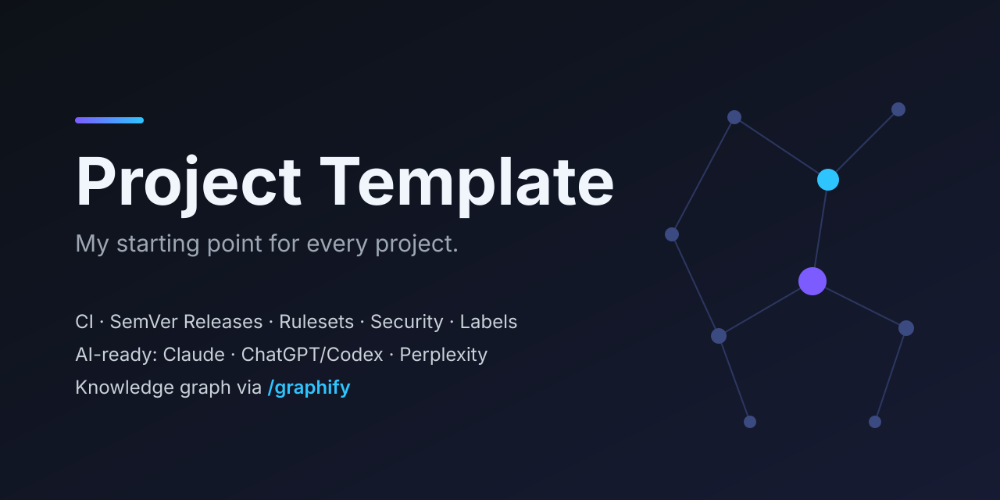

<!-- Neues Projekt? Titel, Beschreibung, Banner und Badges anpassen (tomonfire/template ersetzen). -->
<p align="center">
  
</p>

<h1 align="center">Project Template</h1>

<p align="center">
  <strong>Mein persönliches Template, von mir für mich: der Startpunkt für alle meine Entwicklungsprojekte.</strong><br>
  Jedes neue Projekt startet damit fertig eingerichtet: Qualitätsprüfungen, Vorschau vor der Veröffentlichung,
  automatische Versionen und ein KI-Team aus Claude, ChatGPT/Codex und Perplexity. Alles kostenlos auf GitHub.
</p>

<p align="center">
  <a href="https://github.com/tomonfire/template/actions/workflows/ci.yml"></a>
  <a href="https://github.com/tomonfire/template/releases"></a>
  <a href="https://www.conventionalcommits.org"></a>
  <a href="LICENSE"></a>
</p>

---

## Worum es geht

Dieses Repository ist **meine eigene Vorlage**. Jedes Projekt, das ich starte, egal ob Webseite, App,
Tool oder Experiment, entsteht daraus. So beginnt jedes Projekt mit denselben bewährten Standards und
Abläufen, und ich muss nichts davon jedes Mal neu zusammensuchen.

- **Einheitlich:** gleiche Struktur, gleiche Befehle, gleiche Regeln in allen Projekten
- **Sicher veröffentlichen:** jede Änderung erst als Vorschau, dann Staging, dann live
- **KI-gestützt, aber sparsam:** ein KI-Team klärt zuerst die Anforderungen und baut dann nur das Nötige
- **Kostenlos:** nur GitHub und Open-Source-Werkzeuge; einzig die KI-Abos (Claude, ChatGPT, Perplexity) kosten

> Bewährt sich in einem Projekt etwas Neues, wandert es zurück in dieses Template.

## Neues Projekt starten

1. Oben auf **Use this template → Create a new repository** klicken und **Public** wählen.
   Nur öffentliche Repos bekommen alle Funktionen von GitHub kostenlos.
2. Einmal lokal einrichten:

   ```bash
   git clone git@github.com:<name>/<repo>.git && cd <repo>
   ./scripts/bootstrap.sh            # Werkzeuge installieren
   ./scripts/init-stack.sh list      # Programmiersprachen anzeigen
   ./scripts/init-stack.sh web       # eine wählen (im Zweifel: python, für Webseiten: web)
   ./scripts/setup-github.sh         # GitHub einrichten: Schutzregeln, Pages, Stufen, Labels
   ```

3. Loslegen, z. B. in Claude Code: `/team Ich möchte eine Seite, auf der …`

<details>
<summary><strong>Checkliste für ein neues Projekt</strong></summary>

- [ ] Repo ist **öffentlich**
- [ ] **README:** Titel, Beschreibung, Badges; Banner anpassen oder entfernen
- [ ] **`.github/about.json`:** Kurzbeschreibung und Stichworte (Topics) für GitHub
- [ ] **`AGENTS.md`:** Abschnitt *Projekt* ausfüllen (2–3 Sätze: was, für wen)
- [ ] Stack gewählt (`./scripts/init-stack.sh …`) und `./scripts/setup-github.sh` ausgeführt
- [ ] **`CHANGELOG.md`** und **`.release-please-manifest.json`** (`0.0.0`) zurücksetzen
- [ ] Social-Preview-Bild hochladen (*Settings → General → Social preview*)
- [ ] Sobald Code existiert: `/graphify .` in Claude Code und `graphify-out/` committen

</details>

## Was steckt drin

| Bereich                     | Was es für dich tut                                                                      |
| --------------------------- | ---------------------------------------------------------------------------------------- |
| 🧩 **Programmiersprachen**  | 6 fertige Vorlagen: Web, TypeScript, Python, Go, Rust, Java, alle mit denselben Befehlen ([Hilfe zur Wahl](docs/stacks.md)) |
| 🔍 **Vorschau → Live**      | Jede Änderung zuerst als Vorschau, dann Staging, dann Produktion mit deiner Freigabe ([Ablauf](docs/environments.md)) |
| 👥 **KI-Team**              | Business Owner, Senior Developer, UI/UX-Experte, QA-Reviewer als Claude-Agents (`/team`) |
| 🤖 **KI-Assistenten**       | Claude, ChatGPT/Codex und Perplexity teilen sich dieselben Regeln und dasselbe Projektwissen ([Anleitung](docs/ai-tools.md)) |
| 🧠 **Projekt-Landkarte**    | [graphify](https://github.com/Graphify-Labs/graphify) erstellt eine Karte des Codes; die KI findet sich schneller zurecht und verbraucht weniger Tokens |
| ✅ **Qualität**             | Automatische Prüfungen bei jedem Commit und Pull Request: Fehler, Formatierung, versehentlich eingecheckte Passwörter |
| 🏷️ **Versionen**            | Versionsnummern, Release-Notizen und Changelog entstehen automatisch                     |
| 🛡️ **Sicherheit**           | Schutzregeln für den Hauptzweig, Passwort-Scanner, Sicherheitsupdates, vertrauliche Meldungen |
| 🤝 **Zusammenarbeit**       | Vorlagen für Fehlermeldungen, Wünsche und Pull Requests; Labels; Verhaltenskodex         |

## Wie eine Änderung live geht

```text
Pull Request ──► VORSCHAU  …github.io/<repo>/pr-12/     zum Anschauen, Link kommt automatisch
     │ Merge
main ─────────► STAGING   …github.io/<repo>/staging/   alles Fertige zusammen
     │ Release-PR mergen + Freigabe klicken
Version ──────► LIVE      …github.io/<repo>/
```

Webseiten laufen direkt auf GitHub Pages. Server-Programme werden pro Stufe als fertiges Paket
(Container-Image) auf GitHub bereitgestellt und automatisch probegestartet. Details stehen in
[docs/environments.md](docs/environments.md).

## Das KI-Team

`/team <Wunsch>` in Claude Code durchläuft automatisch diese Schritte:

| Schritt | Rolle                 | Modell            | Aufgabe                                                        |
| ------- | --------------------- | ----------------- | -------------------------------------------------------------- |
| 1       | **Business Owner**    | Claude Opus       | Wunsch → klare Anforderungen mit prüfbaren Kriterien           |
| 2       | **Senior Developer**  | Claude Sonnet     | Logik und Tests umsetzen, nur was gefordert ist                |
| 2       | **UI/UX-Experte**     | Claude Sonnet     | Oberfläche, Texte, Barrierefreiheit                            |
| 3       | **QA-Reviewer**       | Claude Sonnet     | Ergebnis gegen die Anforderungen prüfen, Tests laufen lassen   |

**Token sparen:** Das stärkste und teuerste Modell arbeitet nur dort, wo Denken am meisten bringt, also bei
den Anforderungen. Umsetzung und Prüfung übernimmt das günstigere Modell. Die Agents lesen gezielt,
antworten knapp und dürfen höchstens zwei Korrekturrunden drehen. Für Marktrecherche kann der Business Owner
zusätzlich Perplexity nutzen ([Einrichtung](docs/ai-tools.md#perplexity)).

## KI-Assistenten verbinden

| Assistent                          | Einrichtung                                     |
| ---------------------------------- | ----------------------------------------------- |
| **Claude Code**                    | nichts zu tun, alles ist vorkonfiguriert        |
| **ChatGPT / OpenAI Codex**         | nichts zu tun, Codex liest `AGENTS.md` und `.codex/` |
| **Claude Desktop, Perplexity (Mac)** | `./scripts/mcp-config.sh` zeigt, was einzufügen ist |
| **ChatGPT-/Claude-Projekte, Perplexity Spaces** | `./scripts/export-ai-context.sh` und die Dateien hochladen |

## GitHub-Einstellungen

`./scripts/setup-github.sh` richtet alles mit einem Befehl ein und kann gefahrlos wiederholt werden:

- **Schutzregeln:** Änderungen kommen nur per Pull Request mit grünen Prüfungen in den Hauptzweig.
  Versions-Tags lassen sich nicht mehr verändern.
- **Mergen:** nur „Squash“, damit jeder Pull Request ein sauberer Eintrag in der Historie wird.
- **Sicherheit:** Passwort-Scanner mit Push-Schutz, automatische Sicherheitsupdates, vertrauliche Meldungen.
- **Hosting:** GitHub Pages und die Stufen Vorschau, Staging und Produktion (mit deiner Freigabe).
- **Profil:** Beschreibung, Website, Stichworte (aus `.github/about.json`) und Labels (aus `.github/labels.yml`).

Hinweis: Das Skript braucht die [GitHub CLI](https://cli.github.com/) (`gh auth login`) und [jq](https://jqlang.github.io/jq/).

## Kurz erklärt

| Begriff          | Bedeutung                                                                          |
| ---------------- | ---------------------------------------------------------------------------------- |
| **Repository**   | Projektordner auf GitHub mit kompletter Änderungshistorie                          |
| **Branch**       | Arbeitskopie für eine Änderung, ohne den Hauptstand zu stören                      |
| **Pull Request** | Vorschlag, eine Änderung zu übernehmen, inklusive Prüfung und Vorschau             |
| **Merge**        | Änderung in den Hauptstand (`main`) übernehmen                                     |
| **CI**           | automatische Prüfungen bei jeder Änderung                                          |
| **Release**      | neue, nummerierte Version (z. B. `v1.2.0`), die live geht                          |
| **Stack**        | gewählte Programmiersprache mit ihren Werkzeugen                                   |
| **Token**        | Abrechnungseinheit der KI; weniger Text bedeutet weniger Kosten                    |

## Mitwirken, Support, Lizenz

[CONTRIBUTING.md](CONTRIBUTING.md) · [SUPPORT.md](SUPPORT.md) · Sicherheitslücken: [SECURITY.md](SECURITY.md) ·
Lizenz: [MIT](LICENSE) © tomonfire
